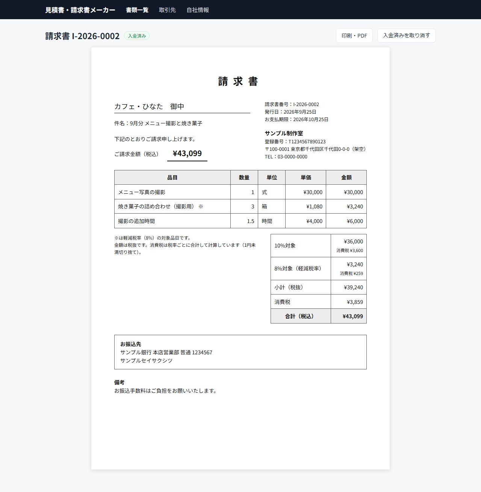
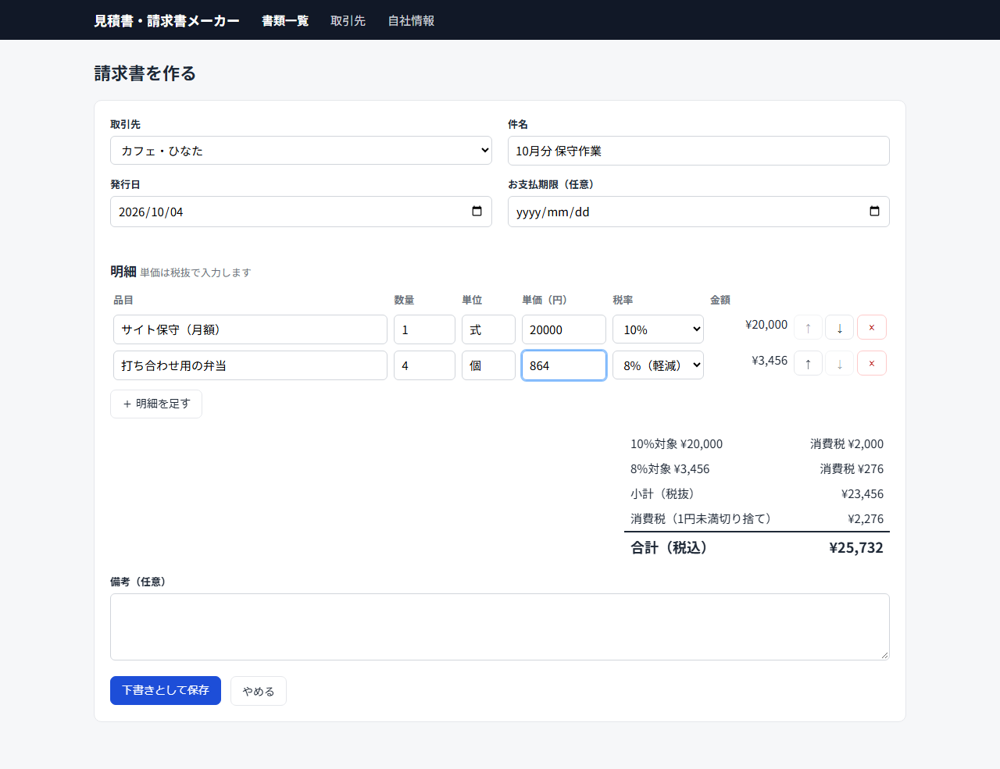

# 見積書・請求書メーカー（invoice-maker）

小さな会社や個人事業主が、見積書と請求書を作って管理するためのWebアプリです。TypeScriptとReact（Next.js）で作りました。
インボイス制度の記載事項と、消費税の端数処理のルール（税率ごとに1回）に合わせています。

クライアント案件ではなく、作り方と品質を見ていただくためのサンプルです。画面の会社名・取引先はすべて架空です。



## できること

- 取引先と自社情報（会社名・登録番号・振込先）を登録する
- 見積書・請求書を作る。明細を足したり並べ替えたりしながら、合計と消費税がその場で出る
- 10%と8%（軽減税率）の品目を1枚に混ぜられる。軽減税率の品目には「※」を付ける
- 見積書から請求書を作る（明細を写す。元の見積書へのリンクも残る）
- 下書き → 発行済み → 入金済み の状態を管理する。発行済みの書類は編集できない
- 印刷用のA4レイアウト。ブラウザの印刷でPDFにできる（[PDF の見本](docs/images/invoice.pdf)）
- 一覧で、番号・件名・取引先名で探す。種類と状態で絞り込む。入金待ちの合計も出す



## インボイス制度への対応

請求書には、国税庁が示す適格請求書の記載事項を載せています（[国税庁「インボイス制度の概要」](https://www.nta.go.jp/taxes/shiraberu/zeimokubetsu/shohi/keigenzeiritsu/invoice_about.htm)）。

| 記載事項 | このアプリでの載せ方 |
|---|---|
| 交付を受ける相手の氏名・名称 | 取引先名＋敬称 |
| 発行者の氏名・名称と登録番号 | 自社情報の会社名と登録番号。登録番号がないと請求書を発行できない |
| 取引年月日 | 発行日 |
| 取引内容（軽減税率の対象品目である旨） | 明細。8%の品目に「※」と注記 |
| 税率ごとの対価の合計と適用税率 | 「10%対象」「8%対象（軽減税率）」ごとの合計 |
| 税率ごとの消費税額 | 税率ごとに計算した消費税 |

消費税は「1枚の書類につき、税率ごとに1回」だけ端数処理します。明細ごとに丸めて足すやり方は認められていないためです（[国税庁 Q&A 問57](https://www.nta.go.jp/taxes/shiraberu/zeimokubetsu/shohi/keigenzeiritsu/pdf/qa/57.pdf)）。たとえば98円の品を3つ売った場合、明細ごとに丸めると税は27円ですが、このアプリではまとめて計算して29円（切り捨て）になります。切り捨て・四捨五入・切り上げは自社情報で選べます。

## 作りで気をつけたこと

金額は整数（円）で計算しています。数量の小数（1.5時間など）も100倍した整数で掛けるので、1.1 × 3のような計算で誤差が出ません。

- 発行済みの書類は、あとで自社情報や端数処理の設定を変えても、記載と金額が変わりません。書類を作ったときの自社情報と端数処理を、書類ごとに残しています
- 書類番号は「種類-発行年-連番」（例: I-2026-0001）で、種類と年ごとに1から振ります
- 入力ミスはその項目の横に出し、入れた内容は消しません。登録番号は全角やハイフンが混ざっていても「T＋13桁」に直します
- 書類のある取引先、請求書の元になった見積書は削除できません
- データベースへの書き込みはトランザクションでまとめ、途中で失敗しても中途半端に残らないようにしています

## 使い方

Node.js 22以降が必要です。

```bash
npm install
npm run seed      # 見本のデータを入れる（不要なら飛ばす）
npm run build
npm start         # http://localhost:3000
```

データは `data/app.db`（SQLite）に保存します。場所は環境変数 `DB_PATH` で変えられます。

## テスト

```bash
npm test          # 計算・業務ルール・入力チェック（Vitest、25件）
npm run test:e2e  # 画面を実際に動かすテスト（Playwright、7件）
```

E2Eテストは、空のデータベースで本番用サーバーを起動し、次の流れを順番に確かめます。

1.自社情報（登録番号の形のチェック）
2.取引先の登録
3. 10%と8%が混ざった見積書の作成と合計
4.発行と、発行後に編集できないこと
5.請求書への変換
6.印刷画面に記載事項がそろっていること
7.入力ミスの表示と削除の制限

## 構成

```
src/lib/tax.ts         金額と消費税の計算（画面とサーバーの両方で使う）
src/lib/schema.ts      入力チェック（zod）
src/lib/repo.ts        データの読み書きと業務ルール（採番・発行後の編集禁止・見積→請求）
src/lib/db.ts          SQLite の接続とテーブル作成
src/app/actions.ts     フォームから呼ばれるサーバー側の処理（Server Actions）
src/app/               画面（一覧・作成・詳細・印刷・取引先・自社情報）
src/components/        紙面・入力フォームなどの部品
e2e/                   Playwright のテスト
scripts/               見本データ、README 用の画面写真
```

## 使った技術

TypeScript、React 19、Next.js 16（App Router・Server Actions）、SQLite（better-sqlite3）、zod、Vitest、Playwright

## このサンプルで省いていること

1人で使う前提のため、ログインと権限の管理は入れていません。複数人で使う場合や、インターネットに公開する場合は、認証を足す必要があります。電子帳簿保存法への対応（検索要件・訂正削除の履歴）も対象外です。

## ライセンス

MIT License
